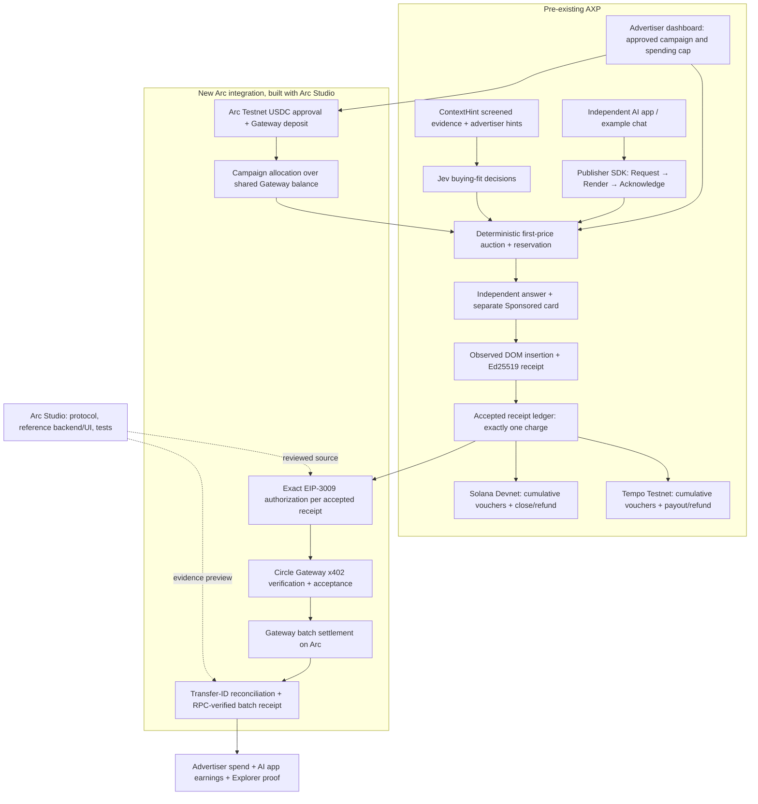

# AXP + Arc Nanopayments architecture

The isolated demonstration uses labelled fixture buyer decisions and a prepared
independent answer. Its deterministic auction, DOM acknowledgement, receipt
signature, ledger, EIP-3009 authorization and Arc/Gateway actions are real. No
new paid Jev/DeepSeek calls occur. Normal AXP retains its actual-provider paths.

## Payment semantics

| Fact | Evidence | Does money move onchain here? |
| --- | --- | --- |
| Campaign funding | Exact approved USDC allowance and Gateway `deposit` transaction | Yes, Arc Testnet |
| Auction reservation | Existing AXP award and budget reservation | No |
| Accepted delivery | App reports insertion and Sponsored disclosure; signed AXP receipt | No |
| Authorization | Official Circle SDK signs exact amount/payer/publisher/domain | No |
| Gateway acceptance | `BatchFacilitatorClient.settle` succeeds; opaque transfer ID | No per-payment transaction |
| Batch finalized | Gateway transfer is `completed`, with successful matching Arc RPC receipt | Yes, shared batch |
| Unused allocation | Unspent part of campaign's Gateway balance allocation | Remains in payer Gateway balance |
| Wallet withdrawal | Separate Gateway withdrawal workflow | Not performed by this MVP |

A receipt proves authenticated app-reported insertion, not attention or
conversion. Gateway's transfer API attributes a nonce to a batch; the RPC check
verifies that batch transaction. It does not independently prove every offchain
allocation inside Circle's batch. The UI preserves that distinction.

## Trust and recovery

The existing backend owns eligibility, integer bid amounts, caps, receipt
acceptance and signing authority. Neither models nor the browser choose payment
amounts, recipients or keys. The Arc signer and publisher recipient are separate
from Solana and Tempo. Six-decimal ERC-20 USDC accounting is separate from
18-decimal native gas accounting. No cross-network totals are summed.

Private SQLite stores frozen terms, exact signed native bytes, payment payloads,
nonces and results. Each is saved before the external send. An unknown outcome
halts new authorizations/auctions across Arc allocations. Explicit reconciliation
looks up the original hash/nonce; it never silently creates another signature,
nonce, deposit or transfer. Read-only browsing performs no external sends.

The Arc worker's tables live in the existing exchange database and participate in
its private snapshots. This branch enables the rail in local runners. Existing
hosted configuration and account-owned serving remain unchanged. Hosted Arc
activation would require separate review, packaging and deployment authorization.
