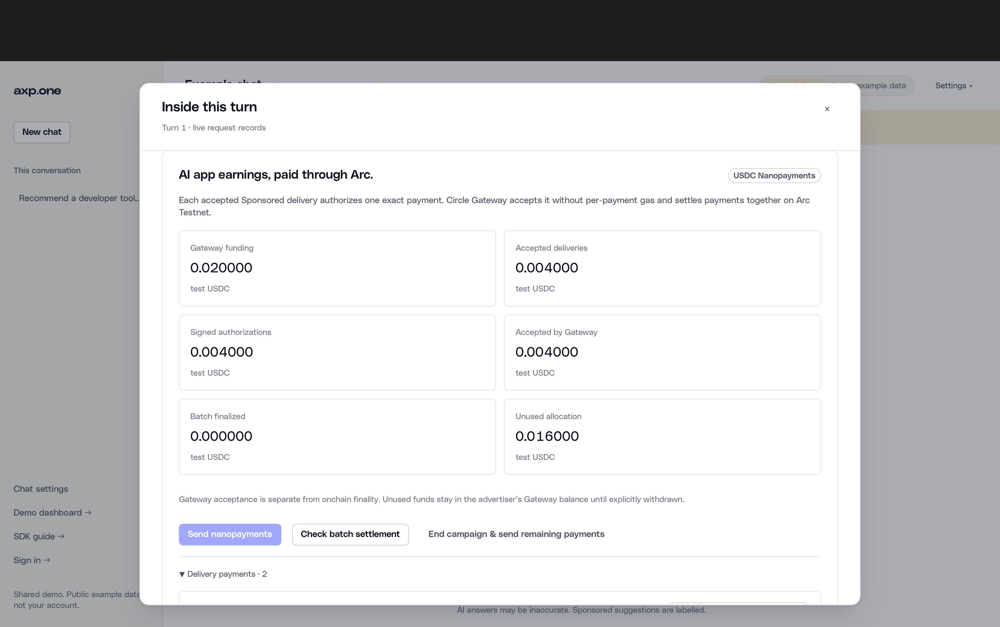

# Arc verification and evidence boundaries

## Baseline and local checks

The checkout began clean on `main` at
`88c9bfbb9ce5d3b532e1a4bff2a276d4c1c1baa4`. Node was absent; an official Node
22.23.4 macOS arm64 archive was checked against Node's published SHA-256 checksum.
Arc Studio CLI 1.2.2 and pnpm 10.18.3 were installed in isolated tool storage;
the verified Node runtime and tools were then retained under the user's local
tool directory. The human completed `arc-studio login` in their own browser.

Locked workspace installation used `pnpm install --frozen-lockfile --ignore-scripts`.
The clean baseline `npm run verify:review` passed. Initial sandbox execution
failed on denied loopback sockets and was rerun with loopback capability; those
failures were environmental, not represented as passing network operations.

The Arc checks exercise campaign/rail binding, actual exchange receipts, exact
per-charge authorizations, duplicate protection, persistence/restart recovery,
unknown outcomes, cross-campaign caps, frozen network facts, SDK signatures,
zero-value native transaction decoding and canonical payment hashing. They use
fixture transports and do not count as live Gateway evidence.

The full review suite passed **828 / 851 repository tests**, with 23 optional
native checks skipped and zero failures, plus **91 / 91 UI component tests**.
Both UI typechecks, React SDK parity, documentation links and repository hygiene
passed. The **13 / 13** targeted Arc tests passed. The production Next static
build passed. The separate read-only preview was typechecked and built locally;
browser visual inspection of that final static package was unavailable after
native Safari controls timed out. See [check record](../../artifacts/arc/checks.json).

## Actual isolated Arc/Gateway run

[Initial acceptance export](../../artifacts/arc/gateway-accepted.json) and
[finalized export](../../artifacts/arc/batch-finalized.json). The private wallet,
SQLite database, signed EIP-3009 payloads and native wire bytes remain only in
ignored `local-state/arc`.

- Payer: `0xe48205ad7745750e2ba38f43f60f61f12757d1fe`
- Publisher: `0x30086df57164ea18b0050b54bbbae9e0aec66901`
- Arc Testnet chain ID: 5042002; native gas USDC uses 18 decimals.
- USDC payment interface: `0x3600000000000000000000000000000000000000`, 6 decimals.
- Gateway Wallet: `0x0077777d7EBA4688BDeF3E311b846F25870A19B9`.
- Exact allowance transaction:
  [Arc Explorer](https://testnet.arcscan.app/tx/0x325d7f858c8db74396878b930e0c6e0b0a25f188bd82bf0b35984edd466ea35b).
- **0.020 test-USDC deposit**:
  [Arc Explorer](https://testnet.arcscan.app/tx/0xd2a7d8330c060608428275fada4c74b6a6581a7c4948aad922c472b814d49e4c).
- Both funding transactions succeeded; combined local native fees:
  **0.003573525 test USDC** (3,573,525,000,000,000 native atto-USDC units).
- Two actual browser DOM insertions yielded two signed accepted AXP receipts and
  two exact **0.002 test-USDC** authorizations. Circle verified and accepted both:
  `932980c6-ccf7-45e3-99c4-9c8d1f55f4e3` and
  `207bcbab-32fe-4dee-b8d4-145d2371311b`.
- **0.004 test USDC accepted by Gateway**. At the initial preserved observation,
  both transfer records were `received`, with no batch transaction hash.
  **Batch finality was pending**, not claimed as paid onchain.
- Both transfers subsequently reached **completed** in one shared batch:
  [Arc batch transaction](https://testnet.arcscan.app/tx/0xcc2e5aabe8828064e2b89064f7f649ac5116edb6eeba091fd1728d76a6dcea7f).
  Independent verification passed both transfer bindings, the successful Gateway
  batch transaction, both funding receipts and both public AXP receipt signatures.
  **0.004 test USDC is batch finalized** and credited to the publisher Gateway balance.
- The 0.016 unused portion of the deposit remains in the payer Gateway balance.
  No publisher wallet withdrawal, automatic refund or mainnet activity is claimed.
- Three prepared answer/buyer attempts include one original no-fill caused by a
  malformed fixture response, which remains preserved. Actual paid Jev/DeepSeek
  calls and spend in this isolated demonstration: zero.

The successful approval was initially conservatively marked unknown because the
transaction decoder omitted a zero-value field. Reconciliation used its original
hash after fixing decoding; no replacement was sent. Original status observations
and exact signed identity remain saved. A later canonical-JSON checksum issue was
caught before facilitator submission. The original saved authorization remained
unchanged and was verified before submission. Tests cover both cases.



## Studio evidence

Studio reported 32 offline adapter tests initially and **44 tests / 227 assertions**
after the final read-only evidence viewer, plus lint/typecheck. These are
Studio-reported results, not a local rerun. Its own funded run did not execute
because its faucet role was denied.
These are separate from the actual local AXP run above.

The superseded initial Studio turn deployed an unused testnet escrow at
`0x1ea0491f04873b012c0c19bf5da96030bd8d1c05`. Its
[transaction](https://testnet.arcscan.app/tx/0x624283d89bfea4ee7edb4533152d7bb5acf91f7ef0bb0ae3c16642e4dbb81e16)
succeeded and used **0.03656485 test USDC** gas. No AXP collateral was sent to it;
it is excluded from the nanopayment implementation and proof. Local funding plus
this deployment consumed 0.040138375 test USDC gas, within the 1 test-USDC ceiling.

## Recheck without signing

```sh
npm ci --ignore-scripts --no-audit --no-fund --prefix tooling/arc-sdk
node scripts/arc/verify-evidence.mjs artifacts/arc/batch-finalized.json
```

The verifier loads no wallet or `.env`. It checks funding calldata, parties,
amounts, receipts, fees and public Gateway transfer state, and validates completed
batch receipts when available. Newer state may be more advanced than the frozen
initial export. Gateway's API supplies the transfer-to-batch association; RPC
checks do not independently decode Circle's offchain accounting.

To save another sanitized observation, with the local private state available:

```sh
node scripts/arc/export-evidence.mjs artifacts/arc/later-observation.json
```

The exporter refuses to overwrite an existing artifact. Never copy the raw
private tables or EIP-3009 authorizations into the repository. The preserved
Solana/Tempo/benchmark evidence elsewhere remains unchanged and is not a new
hackathon execution.

## Account and PostgreSQL boundary review

The shared product Arc API retains existing CSRF/publisher receipt authority.
Account campaign validation in `packages/accounts/resources.mjs` and its PostgreSQL
validator still allow only the original account rails; the account SDK rejects
Arc. Account-owned native funding remains explicitly Solana-only, with owner/org
and verified-wallet checks. Existing RLS ownership predicates, column grants and
service-only financial RPC grants were reviewed and remain unchanged. No schema,
cloud policy or account-owned Arc activation was performed.

## Published branch preview

After human approval, `feature/arc-integration` was pushed. Vercel's existing
Git integration successfully built source commit `be576dc` in **Preview** and
generated the URL recorded in [publication evidence](../../artifacts/arc/preview-publication.json).
The build adds only a read-only Studio evidence viewer at `/arc/` to the existing
site. Local packaged HTTP checks passed the page, two referenced assets, redirect,
seven preserved routes and disabled-signing product health. Ten routing/static
tests passed. No private Arc state was uploaded or activated.

Anonymous HTTP to the actual Preview URL returned **302 to Vercel Authentication**.
The deployment exists and built successfully, but it is not claimed as a public
judge link. No access setting, production promotion or cloud environment change
was performed. Studio workspace judge access remains a separate requirement.
